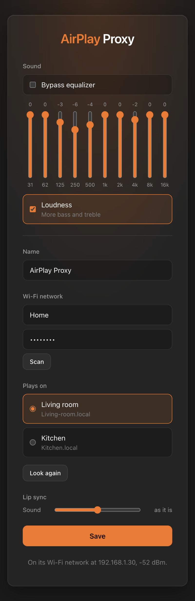

# AirPlay Proxy

**Play any Bluetooth source on your AirPlay speakers, with an ESP32 that costs a few euros.**

Your projector, TV or turntable only speaks Bluetooth. Your HomePod only speaks AirPlay. AirPlay Proxy sits between them: the source sees an ordinary Bluetooth speaker, and the sound comes out of the HomePod, in sync with the picture.

No app, no account, no cloud. Flash the board, pick your Wi-Fi and your speaker from a web page, pair, play.



## Features

- **Bluetooth to AirPlay**, with uncompressed audio all the way.
- **Lip sync.** The proxy tells the source exactly how late the sound is, and the source delays the picture to match. Films and series stay in sync; you can fine-tune it in 5 ms steps.
- **Volume from the source.** The volume buttons of your projector or TV control the HomePod.
- **Setup from your phone.** On first start the board opens its own Wi-Fi network; join it and the setup page opens by itself. No serial cable, no config files.
- **A web page for everything**, at `http://airplay-proxy.local`: name, Wi-Fi network, AirPlay speaker, sound. Switch speaker while music plays and the sound follows.
- **10-band equalizer.** It only cuts, so it never distorts and never eats your volume: all sliders at the top is the original sound.
- **Loudness**, like the button on a 1980s hi-fi amplifier: more bass and more treble.
- **Wi-Fi roaming.** With several access points it moves to the strongest one on its own.
- **Remembers everything** across restarts and reconnects by itself if the network drops.

## Tested with

| | |
|---|---|
| Sources | Magcubic HY320Pro projector (Android 14), iPhone, iPad and other Bluetooth devices |
| Speaker | HomePod mini |
| Board | ESP32-WROVER-E, 16 MB flash, 8 MB PSRAM |

It works with AirPlay speakers that accept a classic AirPlay stream without pairing, as the HomePod mini does.

Lip sync relies on the source honoring Bluetooth delay reports, as Android does. With a source that ignores them the picture runs about 0.8 s ahead of the sound: fine for music, not for films.

## Hardware

You need an **ESP32-WROVER-E** board: an original ESP32 with PSRAM and at least 4 MB of flash. That is all.

Boards that carry it:

- Waveshare ESP32 development boards with the WROVER-E module (the one used here)
- Espressif ESP32-DevKitC-VE
- Espressif ESP32-DevKitC-VIE, with a connector for an external antenna
- LILYGO T7 V1.5
- Freenove ESP32-WROVER

What does **not** work:

- ESP32-S2, S3, C3, C6, H2: they have no Bluetooth Classic, which is what carries audio.
- ESP32-WROOM modules: they have no PSRAM.

A tip on placement: Bluetooth and Wi-Fi share one small antenna on the module. Keep that end of the board clear of metal and of your hand, and reasonably close to an access point. For a case, use PETG rather than PLA: the board runs warm. If your Wi-Fi is weak where the board lives, get the version with the external antenna.

## Install

### Ready-made firmware

Download `airplay-proxy.bin` from the [releases](../../releases) and write it with [espflash](https://github.com/esp-rs/espflash):

```bash
espflash write-bin 0x0 airplay-proxy.bin
```

### Build from source

Install the Rust toolchain for Espressif chips with [espup](https://github.com/esp-rs/espup), plus `ldproxy` and `espflash`. Then:

```bash
source ~/export-esp.sh
make -C proxy flash
```

The first build downloads ESP-IDF v5.4.1 into `proxy/.embuild`; later builds take seconds.

## Getting started

1. Power the board. It opens a Wi-Fi network called `AirPlay Proxy` followed by four characters.
2. Join it from your phone. The setup page opens by itself (if it does not, browse to `http://192.168.71.1`).
3. Tap **Scan**, pick your network, type the password, **Save**. The board restarts and joins your Wi-Fi.
4. Open `http://airplay-proxy.local` and choose your speaker under **Plays on**.
5. On your projector or TV, pair the Bluetooth speaker **AirPlay Proxy**. Play something.

## How it works

```
source ──Bluetooth──▶ buffer ──▶ equalizer + loudness ──▶ AirPlay ──Wi-Fi──▶ speaker
```

The board receives the Bluetooth audio, holds a fifth of a second of it to smooth out the bursts in which Bluetooth delivers, shapes the sound, and streams it over AirPlay with timestamps that tell the speaker when to play each packet. Since the path takes about 0.8 s in all, the proxy reports that delay to the source, which holds the picture back by the same amount.

The source and the board run on different clocks, so the buffer slowly fills or empties; the proxy corrects for it one sample at a time, inaudibly.

Everything is written in Rust on ESP-IDF, and the AirPlay sender, the mDNS discovery, the web server and the audio processing are small crates of their own with tests that run on a computer.

More detail, with the measurements behind each design choice, is in the [engineering notes](docs/notes.md). The [history](HISTORY.md) tells how the project got here in three days.

## Project layout

| | |
|---|---|
| `proxy/` | the firmware: Bluetooth, Wi-Fi, roaming, settings, web page |
| `crates/raop` | AirPlay sender |
| `crates/delay-line` | audio buffer that follows the clock of the source |
| `crates/tone` | equalizer and loudness |
| `crates/mdns` | discovery of speakers, and the `.local` name of the proxy |
| `crates/httpd` | web server |
| `crates/captive-dns` | makes the setup page open by itself on a phone |

Run the tests of a crate with `cargo test` in its directory.

## License

[MIT](LICENSE)
